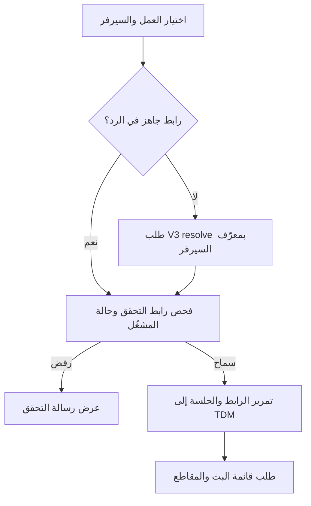

# تحليل مسار التشغيل في OscarTV 1.1.6 ومقارنته بويندوز

> تحديث 24 أكتوبر: فحص الشبكة وفحص التطبيق أعادا `allow / clean` في تجربة
> التوافق، لكن رد المصدر نفسه أعاد ملف الرفض لفيلمين مختلفين. راجع
> `windows-network-reference-status-ar.md` و`windows-network-reference-evidence.json`.
> الفقرات التالية توثق مرحلة التحليل السابقة؛ لا تمثل وحدها الاستنتاج الحالي.

**النتيجة الحالية:** ظهر اختلاف حقيقي في معالجة ردود المصدر، وتم إصلاحه: رابط
`oscartv-guard://…` كان يُعامل في ويندوز كرابط غير مفهوم ثم يُستبدل بحقل HTTP آخر.
تطبيق الهاتف يعامله كأمر تحقق ويوقف الانتقال إلى المشغّل. هذا الإصلاح لا يثبت
استعادة الفيلم المطلوب؛ الاختبار الحي السابق أعاد طلب تثبيت TDM صراحةً.

## الملف وطريقة الفحص

- الملف المرفق: `OscarTV_v1.1.6 (1).apk`، الحزمة `com.drama.mp4`، رقم البناء `18`.
- SHA-256: `b6b23d4f667d4662281bb2a8363d3821d36aa37ecc13e06384227dd96a45326b`.
- استُخرجت خريطة تشمل 157 دالة، ثم روجعت الدوال الحاسمة بتعليمات Dalvik وإحالات
  الاستدعاء. خرج Java مساعد للقراءة؛ لا يُعتمد عليه وحده، لأن أداة الفك أسقطت
  فروعًا من `qq5.b` وأظهرت بعض أنواع المتغيرات بصورة غير صحيحة.
- أداة الاستخراج: `palma-core/tools/trace-oscar-playback.py` مع Androguard 4.1.4.
  تعمل دون شبكة ودون تشغيل التطبيق أو تعديل ملفه.
- لم يُشغّل تطبيق الهاتف داخل أندرويد في هذا الفحص. النتيجة تميز بين تحليل
  تعليمات التطبيق، واختبارات ويندوز السابقة، واختبارات الإصلاح المحلية.
- مقارنة تسليم الرابط إلى المشغّل استعانت أيضًا بتحليل ملف TDM 2.2.2 الموجود
  من التحقيق السابق؛ فهو تطبيق منفصل عن ملف OscarTV المرفق.

## المسار الفعلي



1. عند بدء التطبيق، تُحمّل سياسة `v3guard.tdm` من `BootstrapData`. إن لم تتوافر،
   توجد نسخة محفوظة في `oscar_tdm_guard` وطلب `getTdmGuardPolicyV3`؛ المسار في `t94`.
2. ينشئ `vq5` هوية الجهاز ومفتاحه، ويطلب التحدي ثم تسجيل الجهاز. منصة الهاتف
   المسجلة هي `android`. استجابة التسجيل تحتوي سر الجلسة، وقد تحتوي `hot_token`.
3. معترض `qq5` يوقّع طلبات V3، ويضيف بيانات تحقق مرتبطة بالطلب. معترض `bz`
   يضيف توقيع Iron بعده. `aa2` الخاص بالطلبات القديمة يستثني `/api/v3/` صراحةً.
4. في الفيلم، يقرأ مسار `fi1 → uf3 → tf3 → ea6.j` معرّف العمل ومعرّف السيرفر.
   تُفضّل قيمة `deep_link` ثم `url`. إذا لم توجد قيمة جاهزة، تستدعي `ea6.m`
   الطلب `resolveV3` بالقيم `t`, `cid`, `k`, `lid`.
5. يحصل فحص حجب الإعلانات قبل تنفيذ الانتقال للمشغّل عبر `m85.e → gl0.B`.
   أما `h32.L` فيميز رابط التحقق، ثم يفحص غياب TDM أو قدم إصداره، ثم يفتح Intent.
6. TDM يستقبل رابط الفيديو وبيانات الجلسة في `VideoPlayerActivity.z0` ويجهز طلب
   الوسائط في `F0`. في هذا المسار لا توجد خطوة جديدة لحلّ معرّف الفيلم داخل TDM.

## ما يحتويه تحقق المشغّل X-TE

الدالة `ga5.e` لا تضع اسم المشغّل فقط. تقرأ حالة حزمة أندرويد المثبتة ثم تجمع:

| الحقل | ما تقرأه نسخة الهاتف |
| --- | --- |
| `p` | أول اسم حزمة من سياسة المشغّل، وفي السياسة المفحوصة `com.tdm.manager` |
| `i` | نتيجة وجود الحزمة عبر `PackageManager.getPackageInfo` |
| `pf` | `phone` أو `tv` بناءً على وضع الجهاز |
| `av` | رقم بناء تطبيق OscarTV نفسه، هنا 18 |
| `h` | SHA-256 لشهادة توقيع حزمة المشغّل المثبتة، عبر `c21.X` |
| `e` | هل تعذرت قراءة الشهادة عند وجود الحزمة؛ يساوي صفرًا أيضًا عند غيابها |
| `v` | رقم بناء حزمة المشغّل عبر `c21.K`؛ صفر عند غيابها |

تفحص السياسة المستخرجة وجود الحزمة وشهادتها وحدّ الإصدار الأدنى؛ كانت قيمة
`min_phone` و`min_tv` هي 58. هذه قيم السياسة الملتقطة أثناء التحقيق، وليست ضمانًا
بأن إعداد الخادم لن يتغير لاحقًا.

تحول `ga5.c` هذه البيانات إلى غلاف AES-256-GCM بمفتاح مشتق من سر الجهاز الذي
أصدره المصدر، ومعرّف المفتاح، وnonce الطلب، وتوقيته. بادئة نص اشتقاق المفتاح
هي `oscar-te-v1|…`، وAAD هو معرّف المفتاح. تُرسل النتيجة في `X-TE`.
يُخزَّن قياس حالة المشغّل لمدة 30 ثانية، لكن الغلاف المشفر مرتبط بكل طلب جديد.
اختبار ويندوز السابق طابق صيغة التشفير بمتجه مستقل قبل الاتصال بالمصدر.

إرسال اسم الحزمة أو User-Agent وحده لا يمثل هذه العملية. كما أن وجود ملف APK
على قرص ويندوز لا يساوي نتيجة تثبيت حزمة أندرويد التي تقرؤها هذه الدالة.

## بقية البيانات التي حُسم دورها

| العنصر | ما أثبته الكود | علاقته بالمشكلة |
| --- | --- | --- |
| `X-TG` | `q95.e/b`: قياسات سلامة التطبيق والحزم/الفئات ذات الصلة، مع غلاف مستقل | مسار مختلف عن تحقق وجود TDM؛ ليس رابط مشاهدة |
| `X-AB` | `j8.a/c`: نتيجة فحص الاتصال والحجب وbeacon، وحقول منها `bt` و`bn` | لا يصح وضع نتيجة نجاح ثابتة بدل القياس الفعلي |
| `hot_token`, `X-D-Sig` | `aa2.a` يستثني V3 قبل استخدام التوكن | غياب هذا التوقيع عن `resolve.php` ليس اختلافًا عن الهاتف |
| اشتراك TDM | `n66.R/j0` يقرأ entitlement من ContentProvider ويتحقق من توقيعه؛ `o4.A` يزامنه مع حساب المستخدم | مسار اشتراك وإزالة إعلانات مستقل؛ لا يُستبدل بتوكن محلي مصطنع |
| `tdmvideo://…` | TDM يفك عنوان URL عند ترميزه، ويحمل `cookies`, `user_agent`, `referer` | هذه بيانات جلسة يجب إبقاؤها مع الرابط الصحيح |
| ملفات `.css` و`.js` | `sd.a.K` يضيف ترويسات طلب قائمة البث والمقاطع | كانت هذه المعالجة قد نُقلت إلى ويندوز؛ لم تكفِ وحدها لاستعادة الفيلم |

وجود مساري `X-TG` و`X-AB` لا يثبت أن كليهما سبب الرفض. الردود التشخيصية السابقة
لفحصيهما كانت `allow / noevidence`. أما الدليل الحي الصريح الموجود حاليًا فهو
`tdm_guard.action = install`. قد توجد شروط إضافية لا يحسمها كود العميل وحده.

## الاختلاف الذي أُصلح فعليًا

في الهاتف:

- `j44.K` يميز `oscartv-guard://tamper`.
- `h32.L` يميز `oscartv-guard://adblock` وبقية روابط `oscartv-guard://` قبل فتح المشغّل.
- `g32.K` يقرأ `a` و`s`؛ وحتى `a=no_response` يبقى رد تحكم، لا عنوان فيديو.

في ويندوز قبل الإصلاح، كانت `playbackSource` تلتقط أي خطأ من فك `deep_link`
وتجرب `url` التالي. لذلك أمكن لرد تحكم مع حقل HTTP بديل أن يصل إلى طلب الوسائط.
أثبتت ثلاثة اختبارات جديدة ذلك: فشلت جميعها قبل التعديل، ومنها اختبار وصل
بالفعل إلى دالة تجهيز الوسائط رغم وجود رابط تحقق.

التعديل في `tdm-link.js` و`source.js` يجعل رابط التحقق خطأً محددًا لا يُبتلع
عند تجربة الحقول البديلة. يغطي كذلك الروابط المرمزة والمتداخلة، ويميز فحص
المشغّل وسلامة التطبيق وحجب الإعلانات. الروابط العادية ما زالت تُفك بالطريقة
نفسها. الاختبارات أصبحت ناجحة: 64 للويب و8 لسطح المكتب، بإجمالي 72 محليًا
وعلى ويندوز الفعلي في الاختبار اللاحق.

هذا إصلاح مستقل لمسار رد التحكم. لا ندّعي أنه السبب الوحيد للمقطع السابق:
القائمة السابقة كانت HLS صالحة تحت CDN عادي، وكاشف بصمتها الموجود أصلًا ما زال
ضروريًا لمنع قبول مقطع الرفض المعروف.

## ما ثبت حيًا وما لم يثبت

بعد التعديل، نجح بناء ويندوز والاختبارات الـ72 في
[التشغيل 40026937982](https://github.com/awoadak-glitch/history/actions/runs/40026937982)
عند الالتزام `a218513f636bfdf962ed3e061fc6ad5a350702cf`. فشلت اختبارات الفيلم
HLS والفيلم B2 والحلقة والقناة والتنزيل جميعًا بـ `SOURCE_SESSION_REQUIRED`.
هذا رمز محلي عند اكتشاف قائمة مقطع الرفض المعروف، وليس HTTP 403 من المصدر.
حُفظ التقرير الكامل في `windows-guard-link-verification.json`. لذلك لا يُعد
نجاح البناء دليلًا على إصلاح التشغيل.

في [اختبار ويندوز المفوّض](https://github.com/awoadak-glitch/history/actions/runs/39959748294)،
نجحت challenge/register/detail/resolve برمز HTTP 200. عند التصريح الصحيح بأن
المنصة ويندوز وTDM غير مثبت، أعاد resolve الإجراء `install`. توقف الاختبار قبل
طلب الفيديو. هذا ليس فشل فك تشفير، ولا خطأ اختيار معرّف الفيلم في تلك العينة.

التحليل الحالي يفسر كيف ينتج الهاتف بيانات تحقق المشغّل ويكشف اختلاف معالجة
روابط الرفض. **لم يثبت تشغيل الفيلم المطلوب على ويندوز بعد.** قرار قبول مشغّل
ويندوز وإصدار جلسة بث صالحة يقع عند المصدر؛ لا يحتوي APK على تنفيذ خادم PHP
الذي يتخذ هذا القرار. إكمال المسار يحتاج سياسة تدعم مشغّل ويندوز فعليًا أو
واجهة مصدر معتمدة له، ثم إعادة اختبارات الفيلم والحلقة والقناة والتنزيل.

## إعادة الفحص

```bash
python -m pip install androguard==4.1.4
python palma-core/tools/trace-oscar-playback.py --apk OscarTV.apk --output trace-output
node --test palma-web/tests/source-guard-link.test.mjs
```

يكتب البرنامج `index.json` للإحالات وملفات Dalvik بأسماء الدوال وإزاحات بايت
نسبية داخل كل دالة، وJava عندما ينجح فكها. ملخص الأدلة المنتقاة محفوظ في
`oscar-1.1.6-playback-evidence.json`. لا تتضمن الملفات المسلّمة روابط بث موقعة
أو أسرار جلسات أو مفاتيح أجهزة خاصة.
